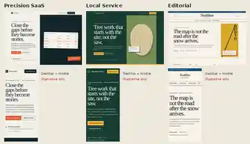

# Ultra Web Design

> **This project is frozen.** The maintained version is [aigent-design-system](https://github.com/wrg32786/aigent-design-system). This repository remains the Apache-2.0 source for the [`aigent-business-sites`](https://github.com/wrg32786/aigent-design-system/tree/master/skills/aigent-business-sites) skill.

## The maintained version is aigent-design-system

**[The maintained version is aigent-design-system](https://github.com/wrg32786/aigent-design-system)**

**[See what it builds](https://tools.theaigent.co/aigent-site-vault)**

Use the successor for new work. It picks a visual direction, builds the site, and checks the result in a real browser. The [Site Vault](https://tools.theaigent.co/aigent-site-vault) is the live showcase: 30 original sites you can browse and open.



**The open-source AI web design Agent Skill for distinctive, production-ready business websites.**

Ultra Web Design is an open-source web design repository on GitHub and a spec-valid
Agent Skill for researching, positioning, designing, building, auditing, and shipping
business websites. It connects product truth, content architecture, visual direction,
responsive implementation, accessibility, motion, performance, SEO, security,
analytics, and release QA without forcing every project into the same AI-generated
layout.

[Project website](https://wrg32786.github.io/Ultra-web-design/) ·
[Source profile](https://wrg32786.github.io/Ultra-web-design/source.html) ·
[Install](#install) · [Examples](#visual-examples) ·
[Complete manifest](skills/ultra-web-design/MANIFEST.md) ·
[aigent-design-system](https://github.com/wrg32786/aigent-design-system)

> **Runtime version:** 2.0.0  
> **Status:** Beta — architecture and structural validation complete; behavioral
> benchmarks are required before promotion to production  
> **Active skill:** [`skills/ultra-web-design/SKILL.md`](skills/ultra-web-design/SKILL.md)  
> **Complete corpus:** [`skills/ultra-web-design/MANIFEST.md`](skills/ultra-web-design/MANIFEST.md)

## Why this web design repository exists

AI can produce a polished landing-page screenshot quickly. The harder job is building
a website that is true to the product, useful to the visitor, distinct from category
clichés, accessible, responsive, fast, maintainable, measurable, and safe to ship.

Ultra Web Design starts with the actual business and implementation system:

- audience, offer, product mechanism, proof, objections, CTA, and success measure;
- existing routes, forms, analytics, SEO, legal language, brand assets, and working
  infrastructure that a redesign must preserve;
- one coherent visual world with a signature system and a restraint system;
- semantic implementation, interaction states, responsive recomposition, keyboard
  behavior, reduced motion, performance budgets, and failure recovery;
- source provenance, truth labels, evaluation contracts, and explicit limits on what
  has not yet been proven.

It is **not** a component library, website theme, fixed frontend stack, or permission
to imitate another brand.

## Install

### Agent Skills CLI

```bash
npx skills add https://github.com/wrg32786/Ultra-web-design --skill ultra-web-design
```

### Manual installation

Copy the complete skill directory into the skill location supported by the agent:

```text
skills/ultra-web-design/
```

The portable unit includes the runtime `SKILL.md`, modules, templates, complete
manifest, and evaluation definitions.

### Direct use

```text
Use skills/ultra-web-design/SKILL.md for this website task. Classify the task
before loading references, read the real repository and product truth, use only
the modules the task requires, and verify rendered output before shipping.
```

## Architecture

Version 2 separates two jobs that should not compete for the same context window:

1. **`SKILL.md` is the lean runtime router.** It contains the authority hierarchy,
   task-size classifier, hard safeguards, reference-loading rules, operating loop,
   and release gates. Tiny fixes take a tiny path.
2. **`MANIFEST.md` is the complete reference corpus.** It preserves the detailed
   source synthesis, business and content systems, visual craft, motion,
   accessibility, performance, SEO, security, operations, templates, audits, and
   provenance. Agents load only the relevant modules.

The runtime file is authoritative during execution. The manifest is the detailed
on-demand reference.

## What it covers

- Business strategy, offer clarity, message hierarchy, proof, objections, and
  conversion architecture.
- Brand authority, visual-world synthesis, composition, typography, color,
  material, imagery, iconography, diagrams, and data display.
- Landing pages, company sites, SaaS, ecommerce, services, media, communities,
  portfolios, courses, events, nonprofits, and public-service websites.
- Responsive recomposition, interaction states, forms, motion, GSAP,
  accessibility, performance, SEO, security, privacy, analytics, CMS operations,
  localization, and RTL.
- Existing-site audits and redesigns that preserve routes, forms, analytics,
  proof, legal language, brand identity, and working business infrastructure.
- Anti-generic release review without imposing one rigid house style.

## Operating principle

The governing loop for substantial website work is:

> **Read → Shape → Inspire → Synthesize → Produce → Build → Taste → Resolve → See → Polish**

Tiny changes take a shorter path. A one-line state defect should not trigger a full
identity exercise. A full redesign should not skip product truth, preservation
inventory, or rendered QA.

## Core safeguards

- The brief and verified product truth outrank model taste.
- Safety, security, data integrity, law, and accessibility are not aesthetic
  preferences.
- Existing working routes, forms, analytics, SEO, proof, legal copy, and brand
  assets are preserved unless an approved decision changes them.
- No testimonials, metrics, customers, prices, ratings, awards, capabilities, or
  affiliations are invented to complete a composition.
- Native platform behavior, standard libraries, existing project patterns, and
  installed dependencies are preferred before new abstractions or packages.
- Distinctiveness comes from product-specific truth, one coherent visual world,
  signature and restraint systems, and category-rut refusal—not novelty for its
  own sake.
- Numeric jury scores are advisory review structure until behavioral calibration
  exists. Hard defects and evidence determine release.

## Visual examples

The repository includes three dependency-free responsive HTML fixtures:

- **[Precision SaaS](examples/precision-saas/)** — product mechanism as proof,
  annotated operational detail, and no invented social proof.
- **[Local service](examples/local-service/)** — a field-guide world shaped by
  geography, site assessment, and service decisions rather than SaaS conventions.
- **[Editorial](examples/editorial/)** — reading-first hierarchy, issue archive,
  sponsor disclosure, and membership after value.

After the repository is public, crawlable versions deploy to the
[project website](https://wrg32786.github.io/Ultra-web-design/#examples).
They demonstrate visual breadth, not conversion performance or customer work.

## Search, citation, and machine-readable metadata

The repository is prepared to function as a clear public source rather than only a
code dump:

- [`CITATION.cff`](CITATION.cff) enables GitHub's citation interface and records the
  preferred author, title, version, license, and canonical URL.
- [`codemeta.json`](codemeta.json) describes the software in a machine-readable
  CodeMeta/Schema.org record.
- [`llms.txt`](llms.txt) gives AI systems a concise map of canonical documents,
  verified facts, limitations, and citation guidance.
- [`site/`](site/) contains a semantic static discovery site with canonical URLs,
  Open Graph and social metadata, JSON-LD, crawler permissions, and a sitemap.
- [`PUBLICATION.md`](PUBLICATION.md) contains the exact public-release, Pages,
  indexing, AI crawler, external-authority, and monitoring checklist.
- [`.github/repository-metadata.yml`](.github/repository-metadata.yml) is the source
  of truth for the GitHub About description, homepage, topics, and social preview.

These files improve clarity and attribution. They do not replace public visibility,
ordinary search indexing, useful original content, real usage, or independent links.

## Repository layout

```text
.
├── README.md
├── PUBLICATION.md
├── CITATION.cff
├── codemeta.json
├── llms.txt
├── AGENTS.md
├── CHANGELOG.md
├── CONTRIBUTING.md
├── LICENSE
├── NOTICE.md
├── site/                         # GitHub Pages discovery source
├── examples/
│   ├── precision-saas/
│   ├── local-service/
│   └── editorial/
├── skills/
│   ├── llms.txt
│   └── ultra-web-design/
│       ├── SKILL.md              # lean runtime authority
│       ├── MANIFEST.md           # generated complete corpus
│       ├── MANIFEST.header.md
│       ├── EVALUATION.md
│       ├── evals/
│       ├── modules/
│       └── templates/
└── scripts/
    ├── build_manifest.py
    ├── build_site.py
    ├── build_social_preview.py
    ├── sync_templates.py
    └── validate.py
```

## Source-of-truth rules

- `SKILL.md` is the runtime execution authority and is edited directly.
- `modules/` is the editable source for the complete reference corpus.
- `MANIFEST.md` is generated by `scripts/build_manifest.py`; do not hand-edit it.
- `modules/08-templates.md` is the template source of truth.
- `templates/` is generated by `scripts/sync_templates.py`; do not allow it to
  drift from module 08.
- `.github/repository-metadata.yml` governs public GitHub metadata.
- `site/`, root `llms.txt`, `CITATION.cff`, and `codemeta.json` govern public search
  and citation facts.
- `NOTICE.md` and the manifest provenance sections retain exact upstream snapshots
  and license notes.

## Templates

Use the smallest set the project needs:

- `PRODUCT.md` — business and evidence source of truth.
- `SURFACE-BRIEF.md` — route-level job, content, states, context, and analytics.
- `DESIGN.md` — executable visual and interaction contract.
- `CONTENT-MATRIX.md` — production content and proof ledger.
- `MOTION-PLAN.md` — motion purpose, ownership, reduced motion, and validation.
- `QA-REPORT.md` — design critique, technical audit, findings, and release status.
- `REFERENCE-COMP-BIBLE.md` — image-first direction and extraction contract.

Delete unused fields instead of preserving empty process theater.

## Validation

Run the repository checks:

```bash
python scripts/build_manifest.py
python scripts/sync_templates.py --check
python scripts/validate.py
skills-ref validate skills/ultra-web-design
```

The checks verify:

- Official Agent Skills frontmatter constraints.
- Runtime progressive-disclosure size and module routing.
- Exact manifest generation from ordered modules.
- Complete numbered corpus and pinned source provenance.
- Exact template synchronization.
- Output and trigger eval definitions.
- Three responsive visual fixtures.
- Search, citation, crawler, structured-data, sitemap, social-preview, and Pages
  packaging.
- Removal of deprecated monolithic-skill build paths.

GitHub Actions performs the same checks and fails when generated files differ from
the committed tree. CI does not repair or push repository state.

## Evaluation

Structural validity does not prove that a skill improves output. The repository
therefore includes:

- Six realistic output-quality cases covering a tiny fix, route extension,
  preserve-mode redesign, greenfield SaaS, editorial work, and audit-only work.
- Twenty trigger queries split between material website tasks and near-miss
  negatives.
- A documented with-skill versus baseline protocol, assertion grading, timing and
  token recording, blind visual comparison, and production-promotion criteria.

See [`EVALUATION.md`](skills/ultra-web-design/EVALUATION.md).
No benchmark number is claimed until the corresponding run artifacts exist.

## Source synthesis

The complete manifest reconciles seven repositories at exact snapshots:

| Source | Primary contribution |
|---|---|
| `pbakaus/impeccable` | Product/design authority, visual-world creation, craft floor, critique, hardening, responsive adaptation |
| `nextlevelbuilder/ui-ux-pro-max-skill` | Searchable design intelligence, catalogs, stack guidance, recommendation provenance |
| `emilkowalski/skills` | Motion purpose, timing, easing, interaction vocabulary, prototyping, animation critique |
| `greensock/gsap-skills` | Official GSAP implementation, timelines, ScrollTrigger, lifecycle cleanup, framework integration |
| `VoltAgent/awesome-design-md` | Comparative grammar distilled from distinct design systems |
| `nexu-io/open-design` | Modular skill architecture, portable design-system packages, artifacts, handoff, provenance, bounded critique |
| `Leonxlnx/taste-skill` | Brief inference, expression dials, anti-habit controls, image-first art direction, redesign preservation, completeness |

Exact commits, license notes, retained knowledge, rejected overfit rules, and
conflict resolution live in `NOTICE.md` and Sections 40–42 of the manifest.

## Updating the project

A source update is accepted only when it changes a website-design or implementation
decision. Record the exact upstream commit, applicable license, canonical files,
concrete contribution, conflicts, retained material, and rejected material.

Public metadata changes must keep README facts, the project site, `llms.txt`,
`CITATION.cff`, `codemeta.json`, repository metadata, and sitemap URLs consistent.
See [`AGENTS.md`](AGENTS.md) and [`PUBLICATION.md`](PUBLICATION.md).

## Status policy

The runtime remains `beta` until the criteria in `EVALUATION.md` pass across the
supported clients and at least three real projects. This is deliberate: the
repository applies the same evidence standard to its own maturity claims that it
requires for website claims.

## Get guidance

Want help putting this to work? The AIgent Academy on Skool offers guidance, courses and a community of builders. Membership comes with a guarantee: you have a business in 90 days or your money back. See the [terms](https://theaigent.co/terms). The full walkthrough is in [The AIgent Academy](https://www.skool.com/the-aigent-academy/about?ref=gh-ultra-web-design).

## License

Apache License 2.0. See [`NOTICE.md`](NOTICE.md) for upstream provenance and
third-party license notes.
